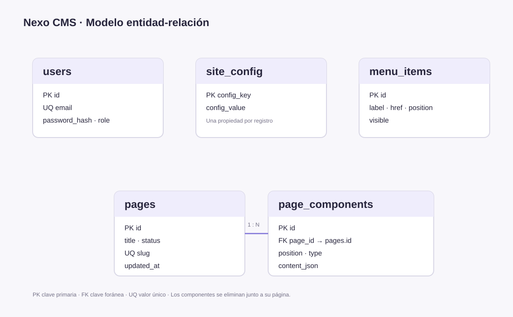

# Semana 1: Cimientos

## Objetivo

Preparar la base del proyecto Nexo Store: definir el modelo de datos, iniciar un
servidor Node.js y exponer endpoints para iniciar, consultar y cerrar una sesión.

## 1. Diagrama entidad-relación



El modelo tiene estas entidades:

| Entidad | Clave y propósito |
| --- | --- |
| `users` | `id` es la clave primaria; `email` es único. Guarda el hash de la contraseña y el rol. |
| `site_config` | `config_key` es la clave primaria. Guarda cada propiedad de configuración del sitio. |
| `pages` | `id` es la clave primaria; `slug` es único. Guarda el título, estado y fecha de actualización. |
| `page_components` | `id` es la clave primaria y `page_id` referencia a `pages.id`. Guarda los bloques ordenados de cada página. |
| `menu_items` | `id` es la clave primaria. `position` es único para mantener el orden del menú. |
| `products` | `id` es la clave primaria. Guarda el catálogo y el precio en centavos. |

La relación principal es **pages 1:N page_components**: una página puede tener
varios bloques, y al eliminarla también se eliminan sus bloques. El esquema se
crea al iniciar la aplicación en `src/lib/db.ts`.

Este proyecto usa SQLite mediante `sql.js`; no requiere instalar PostgreSQL. El
diagrama representa el mismo modelo relacional y se puede adaptar a PostgreSQL
si el curso lo solicita.

## 2. Servidor Node.js

La aplicación usa el servidor Node.js de Next.js. Las rutas API se ejecutan con
el runtime `nodejs`; el servidor local se inicia desde la carpeta del proyecto:

```powershell
npm.cmd install
Copy-Item .env.example .env.local
npm.cmd run dev
```

Configura `ADMIN_EMAIL`, `ADMIN_PASSWORD` y un `JWT_SECRET` propio de al menos
32 caracteres en `.env.local`. Luego abre `http://localhost:3000`.

## 3. Endpoints de autenticación

### Iniciar sesión

`POST /api/auth/login`

Petición JSON:

```json
{
  "email": "correo configurado en ADMIN_EMAIL",
  "password": "contraseña configurada en ADMIN_PASSWORD"
}
```

Con credenciales válidas responde con el correo y rol del usuario, y establece
la cookie `nexo_session` como `httpOnly`. La contraseña se compara con su hash;
no se almacena ni devuelve en texto plano.

| Estado | Significado |
| --- | --- |
| `200` | Inicio de sesión correcto |
| `400` | Faltan o son inválidos el correo o la contraseña |
| `401` | Las credenciales no coinciden |

### Consultar sesión

`GET /api/auth/session`

Requiere la cookie de sesión. Responde con el correo y rol del usuario, o con
`401` si no existe una sesión válida.

### Cerrar sesión

`POST /api/auth/logout`

Expira la cookie `nexo_session` y responde `{"success":true}`.

## 4. Prueba manual

Se puede importar `postman_collection.json` en Postman y ejecutar, en orden,
**Iniciar sesión**, **Consultar sesión** y **Cerrar sesión**. Usa las
credenciales configuradas en `.env.local`; Postman conservará la cookie entre
peticiones.

Las rutas están implementadas en:

- `src/app/api/auth/login/route.ts`
- `src/app/api/auth/session/route.ts`
- `src/app/api/auth/logout/route.ts`
